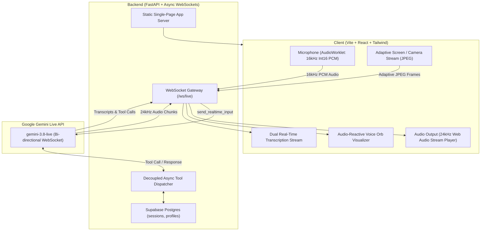

# ⚡ LivePrep – Your Personal AI Mock Interviewer & Voice Coach

> **Powered by Google Gemini 3.8 Live API (`gemini-3.8-live`)**  
> *An ultra-low latency, bidirectional real-time AI mock interviewer that conducts voice-based interviews, evaluates answers, tracks candidate progress, and adapts to English, Hindi, and Hinglish in real-time.*

[](#quick-start-guide)
[](https://ai.google.dev)
[](LICENSE)

---

## 🌟 Core Highlights

- 🎙️ **Real-Time Bidirectional Voice**: Custom browser `AudioWorklet` streaming 16kHz PCM audio to Gemini Live and receiving 24kHz studio-quality PCM responses with sub-second latency.
- 🛡️ **Acoustic Echo Shield (Anti-Self-Interruption)**: Dynamically ducks microphone sensitivity and isolates speaker output while the AI talks, preventing laptop speakers from interrupting the AI mid-sentence.
- ⚡ **Instant Barge-in (Interruption Handling)**: Speak with deliberate intent while the agent is talking, and the playback buffer flushes instantly.
- 👁️ **Adaptive Motion Vision**: Smart pixel-differential analysis only transmits frames when the screen changes (saving 80% tokens & bandwidth) with a 6s heartbeat and instant manual snapshot trigger.
- 🔐 **Per-user login**: Sign in with an email code (Supabase Auth). Every live call is tied to your account and stored as a session in Postgres. One live call per user at a time.
- 🔒 **No model tools**: The AI has no shell, file, web or database access. Scoring and feedback reports are produced on the server after the call (coming in the next steps).
- 🔄 **Context Window Compression & Resumption**: Native `SlidingWindow` compression prevents 10-minute session expiration.
- 🎨 **Futuristic Cockpit UI**:
  - Interactive audio-reactive **Voice Orb** that pulses and shifts color dynamically (Idle, Listening, Thinking, Speaking).
  - Picture-in-Picture Vision Stream preview with Instant Snapshot trigger.
  - Dual live transcription feed with recognized user speech and agent transcripts.
  - Real-time collapsible tool execution drawer with arguments, durations, and output streams.

---

## 🏗️ Architecture



---

## 🚀 Quick Start Guide

### 1. Requirements
- **Python**: 3.10+
- **Node.js**: 18+ (tested on Node v20/v24)
- **Gemini API Key**: From [Google AI Studio](https://aistudio.google.com/app/apikey)

### 2. Configure API Key
Create a `.env` file in the `backend/` directory or simply enter your key inside the app's Settings modal in the browser:
```bash
cd backend
copy .env.example .env
```
Inside `.env`, set:
```ini
GEMINI_API_KEY=AIzaSy...your_actual_key_here
```

### 3. Launch the Application

#### Option A: 1-Click Launch (Windows)
Double-click `start.bat`:
```cmd
start.bat
```
*(Automatically starts the Backend on `http://localhost:8000` and Frontend on `http://localhost:3000`)*

#### Option B: Docker (Unified Single-Container Deploy)
```bash
docker compose up --build
```
*(Runs full-stack LivePrep on `http://localhost:8000`)*

#### Option C: Manual Launch
1. **Backend**:
   ```bash
   cd backend
   .\.venv\Scripts\activate   # or source .venv/bin/activate
   python app.py
   ```
2. **Frontend**:
   ```bash
   cd frontend
   npm run dev
   ```

---

## 🗄️ Database & Migrations (PostgreSQL / Supabase)

LivePrep uses PostgreSQL (Supabase) with SQLAlchemy 2 async (`asyncpg`) and Alembic for schema migrations.

### Running Migrations
To apply database migrations to your database:
```bash
cd backend
alembic upgrade head
```

### Creating New Migrations
When adding or updating SQLAlchemy models in `backend/models.py`:
```bash
cd backend
alembic revision --autogenerate -m "describe schema change"
alembic upgrade head
```

### Row Level Security (RLS)
RLS is enabled by default on all tables (`profiles`, `sessions`, `turns`) with a deny-by-default posture.
- Direct database access from client browsers / Supabase client SDKs is blocked from reading or writing unauthorized rows.
- The LivePrep backend application connects via server-side connection (`DATABASE_URL`), and every database repository query explicitly enforces and filters by `user_id`.

---

## 🔐 Authentication (Supabase)

Users sign in with Supabase Auth. The browser receives a short-lived **access token (JWT)** and sends it to the backend as `Authorization: Bearer <token>`.

How the backend checks it (`backend/auth.py`):

1. The token header is read first. Only **ES256** and **RS256** are accepted. `none` and every `HS*` algorithm are rejected before any key is looked up (algorithm-confusion protection).
2. The signature is verified with the project's **public** keys from `SUPABASE_URL/auth/v1/.well-known/jwks.json`. No secret is stored on our server. Keys are cached for 1 hour; an unknown key id triggers at most one refresh per minute.
3. `exp`, `iat`, `sub`, `aud` (default `authenticated`) and `iss` (`SUPABASE_URL/auth/v1`) are required and checked. `sub` must be a UUID. This is the user id used to filter every database query.
4. Any failure returns a generic `401`. If the key endpoint cannot be reached, the answer is `503`. Tokens are never logged.

Endpoints: `GET /api/me`, `PUT /api/me/profile`.

**Before you run it**
- Set `SUPABASE_URL` (the server refuses to start without it).
- Open `<SUPABASE_URL>/auth/v1/.well-known/jwks.json` in a browser. It must list at least one key. If it shows `{"keys":[]}`, the project still uses the legacy HS256 secret: in the Supabase dashboard go to *Project Settings > JWT Keys* and migrate to an asymmetric (ES256) signing key. Until then the API answers `503`.

**When the signing key is rotated**
Supabase publishes old and new keys together during a rotation. The backend picks the right key by `kid`, so no restart is needed. Tokens signed by a revoked key stop working once it disappears from the key set (cache: up to 1 hour).

**Run the tests**
```bash
cd backend
pip install -r requirements-dev.txt
python -m pytest -q
```
Tests use throw-away keys and an in-memory database. They never read your real `.env`, database or Supabase project.

## 🔑 Sign-in and live-call flow

1. The browser signs the user in with Supabase (email one-time code) and keeps the access token.
2. To start a call it sends `POST /api/ws-ticket` with `Authorization: Bearer <token>` and gets a **one-time ticket** (random, valid 60 s, usable once). A browser WebSocket cannot send headers, and the long-lived token must never go into a URL, so a ticket is used instead.
3. It opens `/ws/live` and sends `{"type":"auth","ticket":"..."}` as the first message (10 s timeout). Anything else closes the socket with code `1008` before it can take a session slot.
4. The server checks the origin, burns the ticket, allows one live call per user, checks capacity (`1013` = busy), creates the `sessions` row **itself** (the client never chooses `session_id` or `user_id`) and starts the Gemini Live session.
5. When the call ends the row is finalized (`ended_at`, `duration_s`, `status`) and the socket is closed with `1000`.

The ticket store is in memory, so run **one backend instance** for now (see `backend/tickets.py`; Redis is the planned replacement).

---

## 📊 Post-session reports

When a call ends, the server stores the session and queues a **report job** for it:

1. `backend/reports.py` computes objective metrics in plain Python: user words, speaking time, WPM, average and longest pause, fillers (approximate), type-token ratio, unique words, most repeated words and average answer length.
2. If the candidate spoke fewer than 30 words, no model is called: the report is stored as `ready` with guidance instead of fake scores.
3. Otherwise the transcript, metrics and profile are sent to the text model in `REPORT_MODEL` with the fixed rubric `v1`. The answer must be valid JSON for a strict schema (scores 0-100, exactly 3 strengths, exactly 5 action steps); an invalid answer is retried once, then the report is stored as `failed`.
4. The result lands in the `reports` table (`pending` -> `ready` / `failed`), owner-scoped like every other query. Re-running the job replaces the row.

Endpoints (all require `Authorization: Bearer <token>` and filter by the token's user id):

| Method | Path | Purpose |
|---|---|---|
| GET | `/api/sessions/{id}/report` | `pending`, `ready` (with analysis) or `failed`, plus the previous session's scores for deltas |
| POST | `/api/sessions/{id}/report/retry` | Regenerate a missing/failed report (idempotent) |
| GET | `/api/progress?limit=10` | Scores of the latest ready reports, for the trend chart |

UI: `#/sessions/<id>/report` shows the overall score, five skill scores, objective metrics, strengths, grammar fixes, words to upgrade, interview feedback and the 5-step action plan; `#/progress` shows the score trend and skill averages.

**Honesty rules built into the rubric**
- `pronunciation` is always `null` with "Audio-based pronunciation analysis coming soon" (audio is not stored yet; a real score needs Step 12).
- The filler metric is labelled *approximate*: transcription can miss fillers.
- Hindi/Hinglish code-switching is not penalised as a grammar error, only mentioned.
- Transcript and profile text are treated as untrusted data: sanitised, wrapped in delimiters, and the prompt instructs the model to ignore instructions inside them.

**Setup**: run `alembic upgrade head` to create the `reports` table, and set `REPORT_MODEL` (for example `gemini-2.5-flash`). `REPORT_AUTO_GENERATE=0` disables automatic generation (used by the test suite); `REPORT_LLM_TIMEOUT_SECONDS` (default 45) bounds one model call.

**Cost guards** (every live minute and every rebuild costs money)
- `DAILY_MINUTES_LIMIT` (default 30, `0` disables): practice minutes per user per UTC day; a call over the allowance is refused with an explanation, and `GET /api/me` returns `usage {limit_minutes, used_minutes, remaining_minutes}`.
- `REPORT_RETRY_LIMIT` / `REPORT_RETRY_WINDOW_SECONDS` (default 10 per hour): rebuild budget per user; over it the endpoint answers `429` with `Retry-After`.
- `MAX_CONCURRENT_REPORT_JOBS` (default 2): report jobs running at once.
- `REPORT_RECOVERY_LIMIT` (default 20): on startup the server rebuilds reports a previous process left `pending` (a deploy or crash used to leave the page polling forever).

### Supabase setup for email sign-in
1. *Authentication > Sign In / Providers*: **Email** enabled (it is by default).
2. *Authentication > URL Configuration*: set **Site URL** to `http://localhost:3000` and add `http://localhost:3000`, `http://localhost:8000` (and your deployed https URL) to **Redirect URLs**.
3. Frontend settings go in `frontend/.env` (copy `frontend/.env.example`): `VITE_SUPABASE_URL` and `VITE_SUPABASE_PUBLISHABLE_KEY` (the *publishable* key, never the secret/service_role key). For Docker/Render these are build arguments, because Vite bakes them into the bundle.

**Link or code?** By default Supabase emails a **sign-in link**: click it and you are signed in (the login screen handles this). A **6-digit code** only appears if the email template contains `{{ .Token }}`, and on the free plan templates can only be edited after you connect your own SMTP provider.

**Limits of Supabase's built-in email service (fine for development only):** very few emails per hour, and it may only deliver to members of your Supabase organization, so your friends/students will not receive emails. Before real users sign up, do one of these:
- connect a custom SMTP provider in *Authentication > Emails > SMTP Settings* (then you can also edit the template to send a code), or
- add Google sign-in (*Authentication > Providers > Google*), which needs no email at all.

## 🌐 Cloud Deployment

LivePrep is containerized and ready for zero-downtime deployment:

### 1. Render / Railway
LivePrep includes [`render.yaml`](render.yaml) for automatic multi-stage Docker deployment.
1. Connect your GitHub repository to Render / Railway.
2. Add the environment variables: `GEMINI_API_KEY`, `GEMINI_LIVE_MODEL`, `REPORT_MODEL`, `ALLOWED_ORIGINS` (your exact https URL), `DATABASE_URL` (Supabase *Session pooler*, port 5432), `SUPABASE_URL`, `VITE_SUPABASE_URL`, `VITE_SUPABASE_PUBLISHABLE_KEY`. Run `alembic upgrade head` once against the database.
3. Set build to Docker. The app will automatically build the React frontend and serve both the web app and WebSockets on port `8000`!

### 2. Google Cloud Run
```bash
gcloud run deploy liveprep \
  --source . \
  --port 8000 \
  --set-env-vars GEMINI_API_KEY="your_api_key_here" \
  --allow-unauthenticated
```

---

## 🧪 Try These Live Scenarios

1. **Voice Conversation & Barge-in**:
   - Click **"Start Live Session"** and allow microphone access.
   - Say: *"Hey LivePrep, who are you and what can you help me with?"*
   - While it's answering, interrupt: *"Wait, hold on, stop!"* -> Notice the audio cuts off instantly!
2. **Visual Screen Debugging**:
   - Click the **Screen Share** button (monitor icon) and share your code editor or browser tab.
   - Say: *"Look at my screen, what code is open right now?"* or *"Can you spot any syntax issues in this file?"*
3. **Mock Interview**:
   - Ask for practice questions or answer an interview prompt: LivePrep gives brief spoken feedback after each answer.
4. **Sign out and back in**:
   - Open the account menu (gear icon) and sign out. Your next visit asks for your email again and sends a new code.

---

## 📂 Project Directory Structure

```
LivePrep/
├── backend/
│   ├── .venv/                   # Python virtual environment
│   ├── app.py                   # FastAPI server & WebSocket live gateway
│   ├── gemini_live.py           # Gemini 3.8 Live API bidirectional session manager
│   ├── auth.py                  # Supabase JWT verification
│   ├── reports.py               # Step 6: metrics, rubric prompt, report pipeline
│   ├── tickets.py               # One-time WebSocket login tickets
│   ├── tools.py                 # Intentionally empty: the model gets no tools
│   ├── requirements.txt         # google-genai, fastapi, uvicorn, sqlalchemy, asyncpg, pyjwt, ...
│   └── .env.example             # Environment configuration template
├── frontend/
│   ├── src/
│   │   ├── audio/
│   │   │   ├── pcm-recorder.worklet.js   # 16kHz PCM downsampler worklet
│   │   │   ├── audio-player.ts           # 24kHz Web Audio queue & barge-in player
│   │   │   └── useLiveSession.ts         # Multimodal state machine & WS hook
│   │   ├── components/
│   │   │   ├── VoiceOrb.tsx              # Audio-reactive canvas glowing particle orb
│   │   │   ├── ScreenPreview.tsx         # Vision stream PiP preview
│   │   │   ├── TranscriptView.tsx        # Real-time dual speech transcription
│   │   │   ├── ToolActivityCard.tsx      # Real-time tool execution drawer
│   │   │   └── SettingsModal.tsx         # API key & Model switcher
│   │   ├── App.tsx                       # Cockpit layout & controls
│   │   ├── index.css                     # Tailwind styling & dark sci-fi theme
│   │   └── main.tsx
│   ├── package.json
│   ├── vite.config.ts
│   └── tsconfig.json
├── docs/
│   └── Contributing.md          # Project contributing guidelines
├── Dockerfile                   # Multi-stage production container
├── docker-compose.yml           # Local & cloud container orchestration
├── render.yaml                  # Cloud 1-click deploy configuration
├── start.bat                    # One-click Windows launch script
└── README.md                    # Project documentation
```

---

## 🤝 Contributing
Please review [docs/Contributing.md](docs/Contributing.md) for contribution guidelines, git branch naming, and community standards.

## 🛡️ License
Apache-2.0
