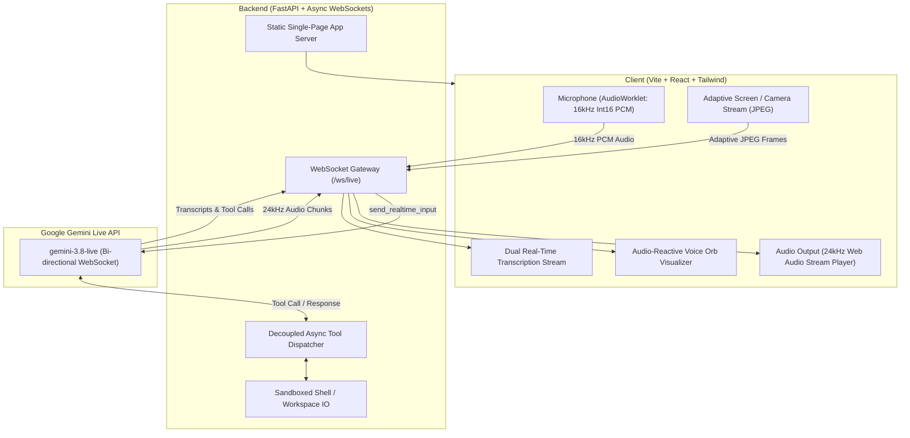

# ⚡ LivePrep – Your Personal Multimodal AI Companion & Voice Agent

> **Powered by Google Gemini 3.8 Live API (`gemini-3.8-live`)**  
> *An ultra-low latency, bidirectional real-time AI companion that listens to your voice, watches your screen/webcam, speaks with natural human voice, and autonomously executes tools on your workspace in real-time.*

[](#quick-start-guide)
[](https://ai.google.dev)
[](LICENSE)

---

## 🌟 Core Highlights

- 🎙️ **Real-Time Bidirectional Voice**: Custom browser `AudioWorklet` streaming 16kHz PCM audio to Gemini Live and receiving 24kHz studio-quality PCM responses with sub-second latency.
- 🛡️ **Acoustic Echo Shield (Anti-Self-Interruption)**: Dynamically ducks microphone sensitivity and isolates speaker output while the AI talks, preventing laptop speakers from interrupting the AI mid-sentence.
- ⚡ **Instant Barge-in (Interruption Handling)**: Speak with deliberate intent while the agent is talking, and the playback buffer flushes instantly.
- 👁️ **Adaptive Motion Vision**: Smart pixel-differential analysis only transmits frames when the screen changes (saving 80% tokens & bandwidth) with a 6s heartbeat and instant manual snapshot trigger.
- 🛠️ **Fully Decoupled Non-Blocking Tool Execution**: Background tasks run in worker threads without blocking incoming audio or transcripts, protected by:
  - 🔒 **Path Traversal Sandboxing**: Restricts all reads and writes strictly to the project workspace.
  - 🛡️ **Destructive Command Guardrail**: Automatically detects and halts dangerous terminal commands.
- 🔄 **Context Window Compression & Resumption**: Native `SlidingWindow` compression prevents 10-minute session expiration.
- 🎨 **Futuristic Cockpit UI**:
  - Interactive audio-reactive **Voice Orb** that pulses and shifts color dynamically (Idle, Listening, Thinking, Speaking).
  - Picture-in-Picture Vision Stream preview with Instant Snapshot trigger.
  - Dual live transcription feed with recognized user speech and agent transcripts.
  - Real-time collapsible tool execution drawer with arguments, durations, and output streams.

---

## 🏗️ Architecture



---

## 🚀 Quick Start Guide

### 1. Requirements
- **Python**: 3.10+
- **Node.js**: 18+ (tested on Node v20/v24)
- **Gemini API Key**: From [Google AI Studio](https://aistudio.google.com/app/apikey)

### 2. Configure API Key
Create a `.env` file in the `backend/` directory or simply enter your key inside the app's Settings modal in the browser:
```bash
cd backend
copy .env.example .env
```
Inside `.env`, set:
```ini
GEMINI_API_KEY=AIzaSy...your_actual_key_here
```

### 3. Launch the Application

#### Option A: 1-Click Launch (Windows)
Double-click `start.bat`:
```cmd
start.bat
```
*(Automatically starts the Backend on `http://localhost:8000` and Frontend on `http://localhost:3000`)*

#### Option B: Docker (Unified Single-Container Deploy)
```bash
docker compose up --build
```
*(Runs full-stack LivePrep on `http://localhost:8000`)*

#### Option C: Manual Launch
1. **Backend**:
   ```bash
   cd backend
   .\.venv\Scripts\activate   # or source .venv/bin/activate
   python app.py
   ```
2. **Frontend**:
   ```bash
   cd frontend
   npm run dev
   ```

---

## 🌐 Cloud Deployment

LivePrep is containerized and ready for zero-downtime deployment:

### 1. Render / Railway
LivePrep includes [`render.yaml`](render.yaml) for automatic multi-stage Docker deployment.
1. Connect your GitHub repository to Render / Railway.
2. Add environment variable `GEMINI_API_KEY`.
3. Set build to Docker. The app will automatically build the React frontend and serve both the web app and WebSockets on port `8000`!

### 2. Google Cloud Run
```bash
gcloud run deploy liveprep \
  --source . \
  --port 8000 \
  --set-env-vars GEMINI_API_KEY="your_api_key_here" \
  --allow-unauthenticated
```

---

## 🧪 Try These Live Scenarios

1. **Voice Conversation & Barge-in**:
   - Click **"Start Live Session"** and allow microphone access.
   - Say: *"Hey LivePrep, who are you and what can you help me with?"*
   - While it's answering, interrupt: *"Wait, hold on, stop!"* -> Notice the audio cuts off instantly!
2. **Visual Screen Debugging**:
   - Click the **Screen Share** button (monitor icon) and share your code editor or browser tab.
   - Say: *"Look at my screen, what code is open right now?"* or *"Can you spot any syntax issues in this file?"*
3. **Autonomous Tool Execution**:
   - Say: *"Check the files in my current workspace."* -> LivePrep triggers `list_directory`.
   - Say: *"Create a python script called fibonacci.py that calculates the 50th Fibonacci number, and run it in the terminal."* -> LivePrep writes the file, runs the command, and reads you the result.
4. **Live Web Grounding**:
   - Say: *"Search the web for recent announcements about Google Gemini 3.8."* -> LivePrep executes `search_web` and speaks a concise digest.

---

## 📂 Project Directory Structure

```
LivePrep/
├── backend/
│   ├── .venv/                   # Python virtual environment
│   ├── app.py                   # FastAPI server & WebSocket live gateway
│   ├── gemini_live.py           # Gemini 3.8 Live API bidirectional session manager
│   ├── tools.py                 # Sandboxed async tools (Terminal, FS, Search)
│   ├── requirements.txt         # google-genai, fastapi, uvicorn, websockets, duckduckgo-search
│   └── .env.example             # Environment configuration template
├── frontend/
│   ├── src/
│   │   ├── audio/
│   │   │   ├── pcm-recorder.worklet.js   # 16kHz PCM downsampler worklet
│   │   │   ├── audio-player.ts           # 24kHz Web Audio queue & barge-in player
│   │   │   └── useLiveSession.ts         # Multimodal state machine & WS hook
│   │   ├── components/
│   │   │   ├── VoiceOrb.tsx              # Audio-reactive canvas glowing particle orb
│   │   │   ├── ScreenPreview.tsx         # Vision stream PiP preview
│   │   │   ├── TranscriptView.tsx        # Real-time dual speech transcription
│   │   │   ├── ToolActivityCard.tsx      # Real-time tool execution drawer
│   │   │   └── SettingsModal.tsx         # API key & Model switcher
│   │   ├── App.tsx                       # Cockpit layout & controls
│   │   ├── index.css                     # Tailwind styling & dark sci-fi theme
│   │   └── main.tsx
│   ├── package.json
│   ├── vite.config.ts
│   └── tsconfig.json
├── docs/
│   └── Contributing.md          # Project contributing guidelines
├── Dockerfile                   # Multi-stage production container
├── docker-compose.yml           # Local & cloud container orchestration
├── render.yaml                  # Cloud 1-click deploy configuration
├── start.bat                    # One-click Windows launch script
└── README.md                    # Project documentation
```

---

## 🤝 Contributing
Please review [docs/Contributing.md](docs/Contributing.md) for contribution guidelines, git branch naming, and community standards.

## 🛡️ License
Apache-2.0
